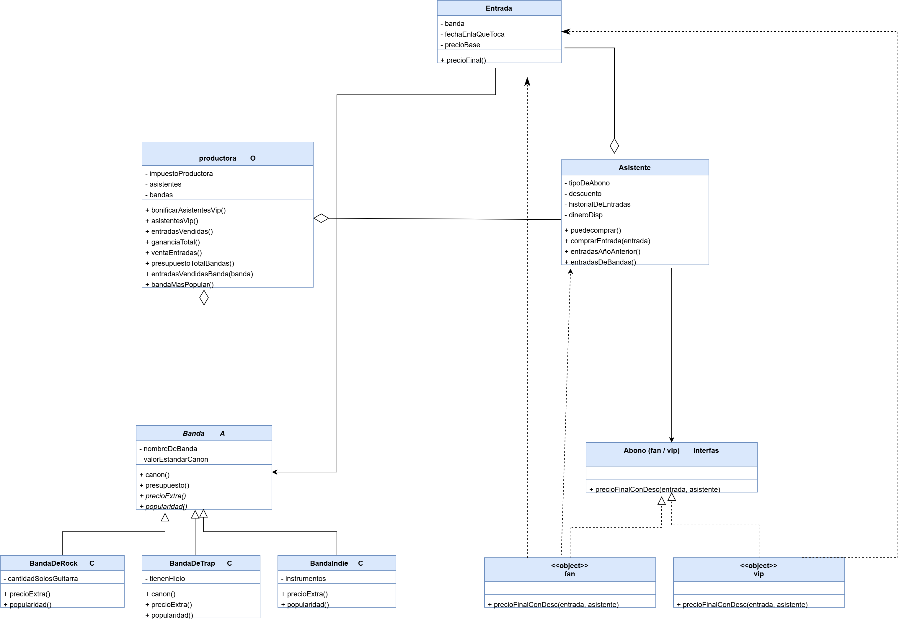

# PDEP Entertainment

TP individual de Objetos – Paradigmas de Programación (K2001) – Tomás Szelubsky

## Decisiones importantes

### Bandas

- **`valorEstandarCanon` vive en `Banda`.** Casi todas las bandas parten del mismo canon base, así que lo puse una sola vez en la superclase y no repetido en cada subclase: si ese valor cambia, se cambia en un solo lugar.
- **`canon()` es un método y no una variable que se lee directamente.** `presupuesto()` y el resto del código piden `canon()`, así `BandaDeTrap` puede hacer un override sin que nada más tenga que cambiar.
- **`presupuesto()` está en la superclase y se apoya en un método abstracto.** El presupuesto (canon más gasto extra) se escribe una sola vez en `Banda`; lo único que varía entre tipos de banda es `precioExtra()`, que queda abstracto y cada subclase resuelve a su manera como hemos visto en clase.

### Abonos (`fan` y `vip`)

- **`fan` y `vip` son objetos y no clases.** No guardan estado propio, solo comportamiento: calcular el precio que paga el asistente.
- **El abono recibe al asistente como parámetro.** Como `vip` es un único objeto compartido por todos, no puede guardar el descuento de cada asistente, así que se lo pide al asistente cada vez que calcula el precio. 

## Conceptos aplicados

### 1. Polimorfismo (abonos y bandas)
`Asistente` le manda `precioFinalConDesc(entrada, asistente)` a su `tipoDeAbono` sin saber si es `fan` o `vip`: ambos entienden el mismo mensaje y cada uno lo resuelve a su manera. Eso permite agregar un tipo de abono nuevo sin modificar `Asistente`. Lo mismo ocurre con las bandas: la productora le pide `presupuesto()` a cualquier banda sin distinguir si es de rock, trap o indie.

### 2. Composición (el abono del asistente)
Un asistente tiene un abono, no es un tipo de asistente. En lugar de crear subclases `AsistenteFan` y `AsistenteVip`, el abono es un objeto que el asistente referencia en `tipoDeAbono` y al que le delega el cálculo del precio. Así, si un asistente cambia de abono, alcanza con cambiar esa referencia, algo que con herencia no se puede hacer porque un objeto no cambia de clase.

### 3. Encapsulamiento
Cada objeto maneja su propio estado y expone comportamiento: `Asistente` actualiza su saldo y su historial dentro de `comprarEntrada` (el que compra no los modifica desde afuera), y `Entrada` sabe calcular su precio final. 

### 4. Responsabilidades y delegación (el pago)
La compra reparte el trabajo así:
- `Asistente` decide si puede comprar, descuenta el monto y registra la entrada.
- El abono (`fan` o `vip`) sabe cuánto se paga según el tipo de abono.
- `Entrada` sabe su precio final (precio base más impuesto).
- `productora` fija el impuesto y arma los reportes.

Cada objeto se encarga solo de lo que le corresponde y le delega a otro lo que no sabe/debe resolver. 

### 5. Herencia y clase abstracta (`Banda`)
`Banda` es la superclase y reúne lo que todas las bandas tienen en común, para no repetirlo en cada subclase. Es abstracta porque no se puede instacias, sirve de molde para las subClases: define lo que cualquier banda tiene que saber hacer y deja que cada subclase resuelva los detalles según su tipo. Gracias a esto, el resto del sistema trata a todas las bandas de la misma manera, sin importar de cuál se trate y se repite menos logica.
